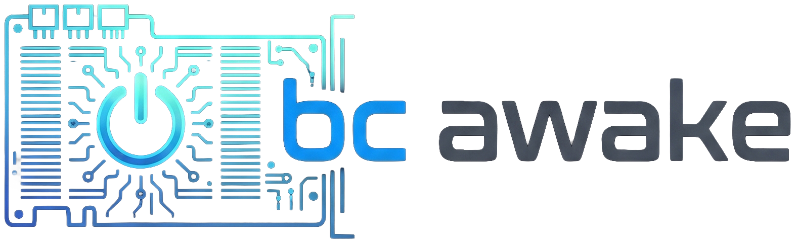

<p align="center">
  
</p>

# BC Awake

[](https://github.com/ffosilva/bc-awake/releases)
[](https://buymeacoffee.com/ffosilva)

### ESP32-based smart ATX PSU switch for AMD BC250 with Bluetooth & Wake-on-LAN

The AMD **BC250** is a powerhouse for budget desktop conversions, living room gaming, and local AI workloads — but because it was designed for mining, it lacks an ATX power button and has **no low-power sleep states**, wasting power and generating heat if left idling 24/7.

**BC Awake** solves this by turning an ESP32 into an intelligent power controller for your ATX/SFX PSU (`PS_ON#`). Instead of leaving the system running or fiddling with power cables, BC Awake keeps the machine completely off and brings it up on demand:

- 🎮 **Living Room Console**: Pick up your Bluetooth gamepad (PS4/PS5, Xbox, Switch Pro, 8BitDo) and press the home button — the PC powers on right from your couch.
- ⚡ **On-Demand AI & Game Streaming**: Wake the machine over Wi-Fi via Wake-on-LAN when connecting through Moonlight, Steam Link, or launching intermittent AI model inference and processing workflows.
- 🔘 **Complete Power Management**: Provides a physical power button, automatic PSU shutoff when the OS halts, optional graceful ACPI shutdown, boot watchdog protection, and a captive Wi-Fi portal with OTA firmware updates.

Supports multiple targets from the same repository:
- **ESP32-WROOM (DevKitC)**: Classic Bluetooth (BR/EDR) controller wake.
- **AI-Thinker ESP32-CAM**: Classic Bluetooth wake with onboard flash LED wake indicator.
- **ESP32-C3 (SuperMini / DevKitM-1)**: Bluetooth Low Energy (BLE) controller wake.

> [!CAUTION]
> **Hardware Disclaimer**: This project involves custom wiring, ATX power line manipulation, and bare-board hardware. The author is **not responsible** for any BC-250 damages, dead cards, fried components, or any kind of losses or damages resulting from using this firmware, schematics, or documentation. Proceed at your own risk!

## Features

- **Push-button power**: tap to turn on; hold 5 s while running to force off.
- **Follows the board**: if the OS shuts the board down, the PSU is cut automatically.
- **Graceful shutdown** (optional): wire the motherboard's `PWR_BTN#` header to the ESP32 and the button (and a portal "Shut down" action) acts like the real power button — see [Graceful shutdown](#graceful-shutdown-optional).
- **Boot watchdog**: if the board doesn't come up within 10 s, the PSU is released.
- **Bluetooth controller wake** (optional):
  - **Classic Bluetooth (BR/EDR)** on ESP32 / ESP32-CAM (PS4/PS5, Xbox, Switch Pro, 8BitDo in Classic mode).
  - **BLE advertisement wake** on ESP32-C3 (controllers operating in BLE mode).
- **Wake-on-LAN (WOL) over Wi-Fi** (optional): wake the BC250 from Moonlight, Steam Link, or mobile WOL apps targeting your PC's Ethernet MAC address.
- **WiFi setup portal**: configure bound controllers and Wake-on-LAN settings from a phone — no reflashing.
- **Over-the-Air (OTA) firmware updates**: update firmware wirelessly via the setup portal web UI.
- **Firmware versioning**: compile-time semantic versioning and target hardware reporting.

## Wiring

The ESP32 is permanently powered from the ATX connector's **5 V standby** (into the
`5V` / VIN pin), so it runs whether the machine is on or off. Share a common ground
between the ESP, the PSU, and the board.

| ESP32 (DevKitC) | ESP32-CAM | ESP32-C3 | Connects to | Notes |
|-----------------|-----------|----------|-------------|-------|
| GPIO25 | GPIO15 | GPIO5 | Momentary switch, terminal A | Read with internal pull-up |
| GPIO26 | GND (header) | GPIO6 | Momentary switch, terminal B | DevKitC/C3 drives LOW; CAM wires directly to GND |
| GPIO32 | GPIO14 | GPIO4 | ATX `PS_ON#` (green wire) | **Open-drain**, active LOW: LOW = PSU on, released = off |
| GPIO34 | GPIO13 | GPIO3 | BC250 `TPMS1` (pin 9) | ~3.3 V when the board is up, 0 when off (ADC voltage) |
| GPIO27 | GPIO2 | GPIO7 | Motherboard `PWR_BTN#` (optional) | Direct wire; high-Z input, pulled LOW only to emulate a press. See [Graceful shutdown](#graceful-shutdown-optional) |
| 5V / GND | 5V / GND | 5V / GND | PSU standby + common ground | Permanent power for the ESP |

> **`PS_ON#` is 5 V.** It idles at ~5 V (pulled up inside the PSU), above the ESP32's
> GPIO maximum (~3.6 V). Open-drain keeps the ESP from *driving* 5 V, but the pin still
> sees it. A small N-MOSFET/NPN buffer (or at least a ~1 kΩ series resistor) is
> **recommended** — see [docs/pinout.md](docs/pinout.md#ps_on-5-v-caution-recommended-buffer).

`TPMS1` is a higher-impedance signal that hovers near the logic threshold, so it's read
as an analog voltage with hysteresis rather than a digital pin (ADC1 on DevKitC and ESP32-C3; digital input with pull-down on ESP32-CAM).

**Full pinout, header diagrams for DevKitC, ESP32-CAM, and ESP32-C3 (SuperMini & DevKitM-1), ATX 24-pin and TPMS1 connector diagrams, and the
`PS_ON#` buffer circuit: [docs/pinout.md](docs/pinout.md).**

## Button controls

| Action | Result |
|--------|--------|
| Tap while **off** | Power on |
| Hold ≥ 5 s while **on** | Force power off |
| Hold ≥ 8 s while **off** | Enter WiFi setup portal |

The button is the primary control and always works, even with no controller configured.

## Graceful shutdown (optional)

By default the only way the ESP can turn the board off is to cut the PSU (`PS_ON#`), which
is a hard power-off. If you also wire the motherboard's front-panel **`PWR_BTN#`** pin to the
ESP32 (GPIO27 on DevKitC, GPIO2 on ESP32-CAM, GPIO7 on ESP32-C3) and enable the feature in the portal's **Power** tab, the ESP behaves like a real power button:

| Action (feature enabled, machine **on**) | Result |
|------------------------------------------|--------|
| Short press | Mirrored to the board: OS gets an ACPI power-button event and shuts down cleanly |
| Hold the button | Mirrored to the board for as long as you hold it, so the board's own long-press override can apply |
| Hold ≥ 5 s | Unchanged backstop: the PSU is cut immediately |

When the board powers down, `TPMS1` goes low and the existing logic releases `PS_ON#`
automatically. There is no timeout: if the OS hangs, you decide (hold the button 5 s to cut
power). Presses made while the machine is off or booting behave exactly as before. The
`PWR_BTN#` line idles at ~3.4 V on the BC250 board, so it is wired directly and the ESP32
never drives it high. Wiring details: [docs/pinout.md](docs/pinout.md).

## Bluetooth controller wake

This uses **classic Bluetooth (BR/EDR)**, the kind used by most gamepads when paired to
a PC (DualShock 4 / DualSense, Xbox Wireless, 8BitDo, Nintendo Switch Pro Controller / Joy-Con).

A powered-on, paired classic controller doesn't advertise; it *pages* its bonded host.
While the machine is **off**, the ESP32 takes on the BC250's Bluetooth adapter address
and runs **continuous, interlaced page listening**:

1. You turn on the controller (e.g. press the **HOME button** on a Switch controller, or
   power button on an 8BitDo/Xbox/PS controller) → the controller pages its host.
2. The ESP32 catches the page and **rejects** the connection (no link, no authentication,
   so the controller's pairing with the BC250 is never touched) but counts it as
   "controller present", and powers the machine on.
3. Once the machine is powering on, the ESP32 goes silent (stops answering pages). The
   controller's next attempt reaches the real BC250 adapter and connects normally.

When controllers are bound (via the portal), the machine **follows any of your bound controllers**:
turn on any bound controller (up to 8 supported simultaneously) and the machine powers up.
After a power-off there's a short guard window so the controller's reconnect burst can't immediately
switch it back on — turn the controller off within that window to keep the machine down.

Requirements:

- The controller must already be **paired to the BC250**.
- You must give the ESP32 the BC250 Bluetooth **adapter MAC**: on Linux run
  `bluetoothctl show` (the `Controller aa:bb:cc:dd:ee:ff` line); on Windows, Device
  Manager → Bluetooth adapter → Properties → Advanced.

## Wake-on-LAN (Network Wake)

The BC250's onboard Ethernet controller is unpowered when the SFX PSU is off, so it cannot
receive Wake-on-LAN packets natively. When **Enable Wake-on-LAN** is configured:

1. The ESP32 connects to your Wi-Fi network in station (STA) mode and listens for standard
   WOL Magic Packets on UDP ports 9 and 7.
2. When a Magic Packet matching your configured **BC250 Ethernet MAC** arrives from a
   streaming app (Moonlight, Steam Link) or LAN tool, the ESP32 asserts `PS_ON#` to boot the PC.
3. Supports both password-protected and open (passwordless) networks.
4. If disabled, the Wi-Fi radio stays completely off in normal mode for zero RF/power overhead.

## Setup portal

When unconfigured (or after a factory reset), the ESP32 **automatically launches the setup portal** (`BC250_<SUFFIX>`) on initial power-up. While in setup mode, the host machine remains safely powered off and unenergized so you can configure the switch from your smartphone, tablet, or laptop.

If the switch is already configured, hold the power button ≥ 8 s while OFF (or send `'s'` over serial while off) to re-enter setup mode.

### Setup Instructions

1. Connect your smartphone, tablet, or laptop to the open Wi-Fi network **`BC250_<SUFFIX>`** and open `http://192.168.4.1`.
2. Create a portal password (min 6 characters).
3. Access the tabbed interface:
   - **Bluetooth tab**:
     - Enter and save your BC250 Bluetooth adapter MAC (run `bluetoothctl show` on Linux to copy it).
     - Manage controllers: bind paired controllers interactively or add MACs manually (up to 8 controllers).
     - (ESP32-CAM) Toggle flash LED blink on wake.
   - **Network tab**:
     - Configure Wake-on-LAN: check **Enable Wake-on-LAN (Wi-Fi)**, enter your home Wi-Fi SSID, password, device hostname, and BC250 Ethernet MAC address (from `ip link`), then click **Save Network Settings**.
   - **Power tab**:
     - Motherboard power button: toggle optional `PWR_BTN#` mirroring for clean OS shutdown on short press.
   - **System tab**:
     - Firmware update (OTA): upload a compiled `.bin` binary wirelessly.
     - Change portal password or reset configuration back to defaults.
     - Click **Exit setup mode & reboot** to restart the switch into normal operation.


## Build & flash

PlatformIO (pioarduino). Flashing is a single step — the setup portal web UI (`app/index.html`) is automatically gzipped and embedded directly into the firmware binary during the build.

**ESP32-DevKitC (`esp32dev`, default — Classic BT wake):**
```bash
pio run -e esp32dev -t upload
```

**AI-Thinker ESP32-CAM (`esp32cam` — Classic BT wake):**
```bash
pio run -e esp32cam -t upload
```
> *ESP32-CAM flashing note*: Use a USB-to-UART adapter (or ESP32-CAM-MB base board). Connect **GPIO0 to GND** before powering on to enter download mode; disconnect GPIO0 and reset to run.

**ESP32-C3 DevKitM-1 (`esp32-c3-devkitm-1` — BLE wake):**
```bash
pio run -e esp32-c3-devkitm-1 -t upload
```

### Over-the-Air (OTA) Updates

Once the device has been flashed with the dual-bank partition table via USB, all future updates can be applied wirelessly:

1. Compile the firmware binary for your target:
   ```bash
   pio run -e esp32dev   # binary generated at .pio/build/esp32dev/firmware.bin
   ```
2. Hold the switch button ≥ 8 s while OFF to enter the setup portal.
3. Connect to **`BC Awake Setup`** (`http://192.168.4.1`) and unlock.
4. In the **Firmware update (OTA)** card, select your `.bin` file and click **Upload & flash**.
5. The device flashes the inactive bank and automatically reboots into the updated firmware.

> **Note on Initial Partitioning**: The switch uses a dual-bank 1.81 MB OTA layout (`partitions.csv`). Transitioning from older single-partition builds requires **one initial wired flash** (`pio run -t upload`) to repartition flash.

## Notes

- **Multi-target support**: Switching between Classic Bluetooth (ESP32 / ESP32-CAM) and BLE (ESP32-C3) is done by choosing the PlatformIO environment target (`-e esp32dev`, `-e esp32cam`, or `-e esp32-c3-devkitm-1`).
- **WiFi TX power** for the portal's SoftAP is `AP_TX_POWER` in
  [include/board.h](include/board.h) (lowered automatically on ESP32-C3 to prevent the mini RF bug).
- Serial debug runs at **115200** baud.
- Pin assignments and all timing constants live in [include/board.h](include/board.h).

## How to Contribute

Contributions are what make open-source projects thrive! Whether you are an experienced embedded developer or just getting started with ESP32s, your help is welcome and deeply appreciated. Every contribution — from reporting a minor bug to adding support for new hardware — helps make BC Awake better for everyone.

### Ways you can help

- **Report bugs and issues**: Encountered unexpected behavior, boot watchdog resets, or connection issues? [Open an issue](https://github.com/ffosilva/bc-awake/issues) detailing your hardware board, controller model, and serial logs (`115200` baud).
- **Suggest features & improvements**: Have ideas for additional controller modes, new hardware targets, or web portal enhancements? Open a feature request to start a discussion.
- **Submit Pull Requests**: Bug fixes, code optimizations, web UI updates, and documentation improvements are all welcome.
- **Test hardware & controllers**: BC Awake supports various ESP32 boards (DevKitC, ESP32-CAM, ESP32-C3) and countless Bluetooth/BLE controllers. Testing on your hardware and reporting what works helps expand our compatibility list.

### Architectural Decisions & OpenSpec

This project uses [OpenSpec](openspec/) to track architectural decisions, system specifications, and planned changes under the `openspec/` directory.

- **Great to have**: If you're planning a larger architectural change or new subsystem, proposing or documenting it via OpenSpec is a fantastic bonus and helps maintain a clear history of design choices.
- **Not a requirement**: You do **not** need to learn or use OpenSpec to contribute. Feel free to open a regular issue or pull request, and we will happily collaborate with you to help integrate your changes and document any specs needed.

### Getting Started with PRs

1. Fork the repository and clone your fork locally.
2. Create a feature branch (`git checkout -b feature/my-feature`).
3. Make your changes and test the build for relevant targets (e.g., `pio run -e esp32dev`).
4. Commit your changes using clear commit messages.
5. Push to your branch and open a Pull Request with a summary of what you did and why.

## Support

If you find BC Awake useful and would like to support its ongoing development, consider buying me a coffee:

<a href="https://buymeacoffee.com/ffosilva" target="_blank">
  
</a>

## License

This project is licensed under the GNU General Public License v3.0 - see the [LICENSE](LICENSE) file for details.
